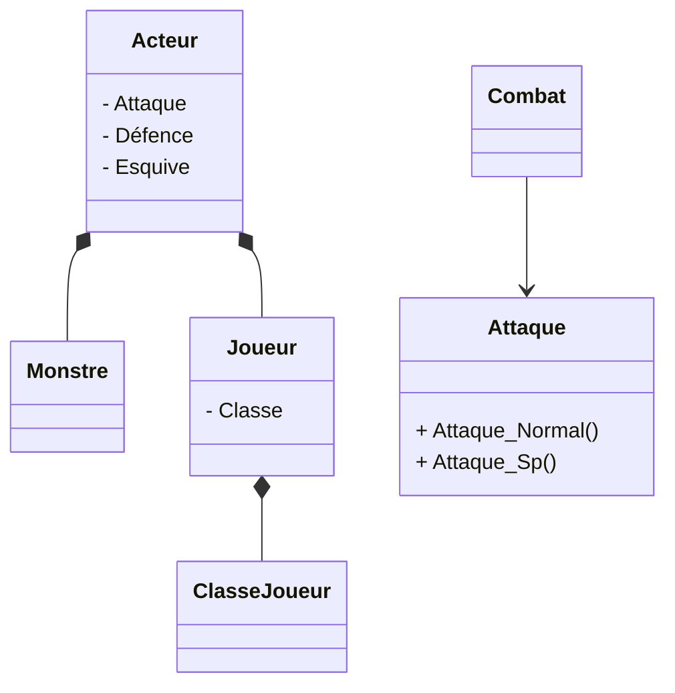

# Projet_WinUI_CombatDonjon

## Description du projet
Le projet est de créer des aventuriers ayant trois classe différentes, chaque classe ayant des stats d'attaque, de défence et d'esquive différentes,
et de se battre contre des groupes de monstres.

L'utilisateur va pouvoir sauvegarder des équipes et les charger via des fichiers Json(peut-être, si je ne trouve pas un meilleur format)
Chaque classe d'aventurier va pouvoir utilisé des capacité différentes

## Les classes
