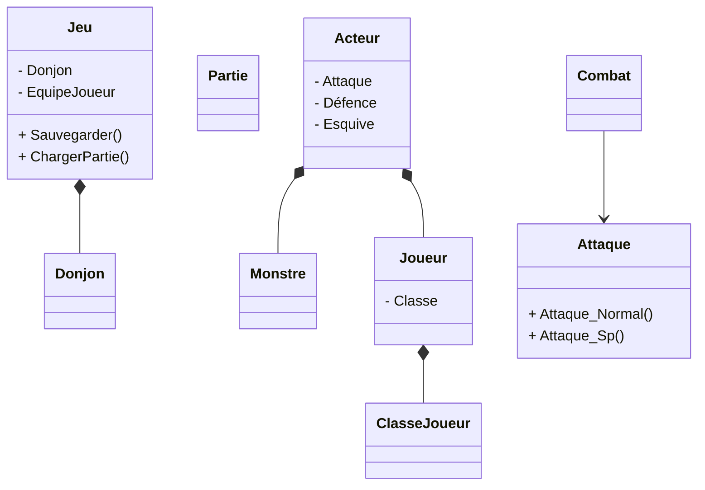
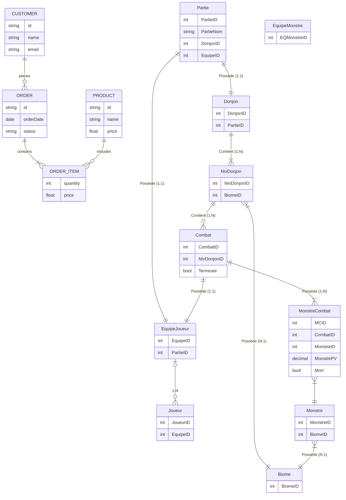

# Commentaires prof
Ton thème est intéressant et peut être conservé, mais le projet doit être une application avec de la gestion de données, dont le combat est une fonctionnalité. Il faudrait préciser la liste des fonctionnalités : ce que l’utilisateur peut créer, modifier, supprimer et consulter ; 
Tel quel, je ne pas vérifier s’il respecte les exigences du projet de session.

L'utilisation d'Entity Framework et d'une base de données est obligatoire. Les données doivent être sauvegardées dans la BD, pas dans des fichiers JSON.

le losange plein représente une composition, et non l'héritage (flèche à triangle vide). De plus, plusieurs aventuriers partagent la même classe : c’est une association, pas une composition. Les équipes, les groupes de monstres et les capacités sont absents du diagramme. Attaque est un comportement (méthodes), pas une entité à sauvegarder.
Dates : ton projet doit manipuler des dates (ex. date de création d'une équipe, historique des combats).

# Projet_WinUI_CombatDonjon

## Description du projet
Le projet est de créer des aventuriers ayant trois classe différentes, chaque classe ayant des stats d'attaque, de défence et d'esquive différentes,
et de se battre contre des groupes de monstres.

L'utilisateur va pouvoir sauvegarder des équipes et les charger via des fichiers Json(peut-être, si je ne trouve pas un meilleur format)
Chaque classe d'aventurier va pouvoir utilisé des capacité différentes

## Les classes

## Schémat Entité-Relation
